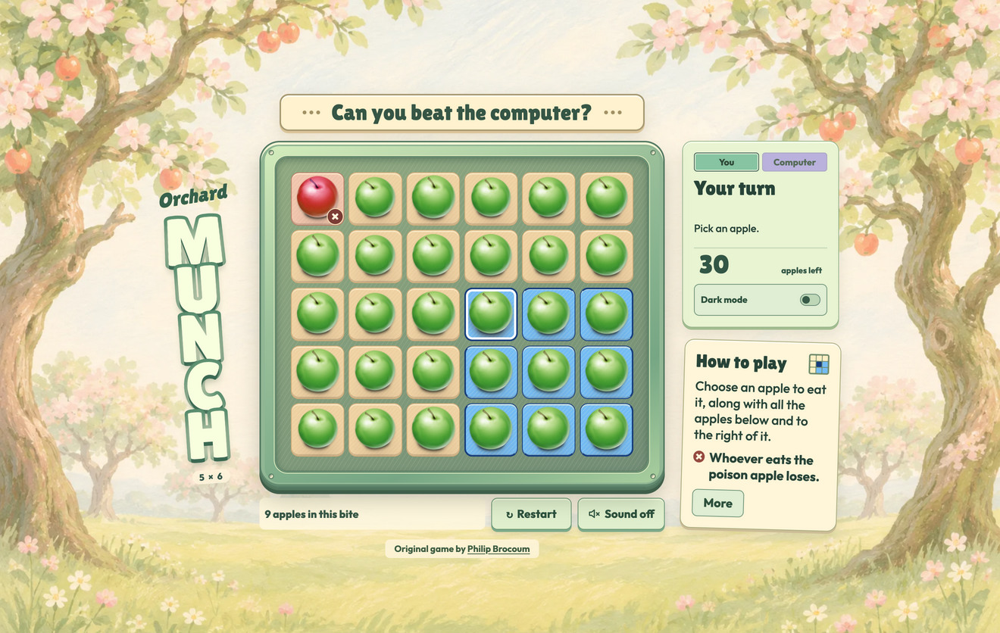

# Orchard Munch

[Play Orchard Munch](https://stedwick.github.io/munch/) and see if you can beat the computer.

You go first. Choose an apple to eat it, along with all the apples below and to the right of it. Whoever eats the red poison apple loses.

Use the arrow keys to move between apples and Enter to choose one. Use **Dark mode** to change the orchard and **Sound off** to turn on the music and effects.

## GitHub Pages

GitHub Pages publishes the game from `docs/` on `main`. The original game is archived in `docs_old/`.

Original game by [Philip Brocoum](https://phils.app).
